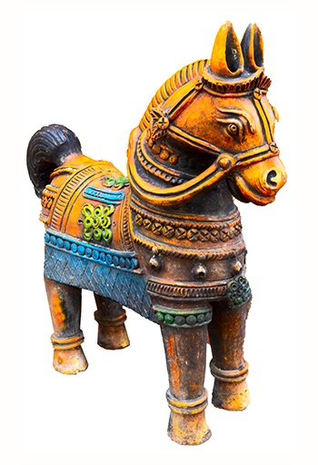
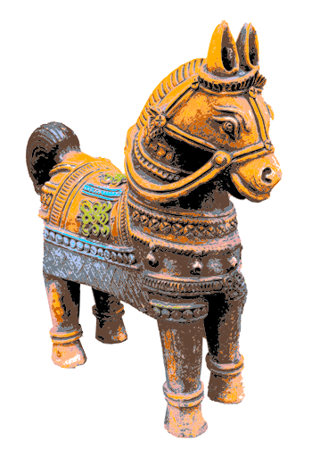
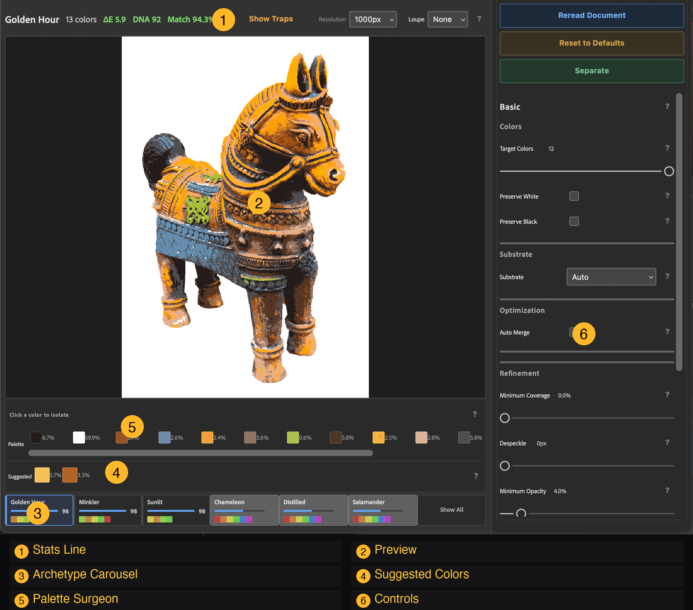

<p align="center">
  
</p>

# Reveal

**Mesh-aware color reduction for screen printing: a Photoshop plugin and a pure JavaScript engine**

[](LICENSE)

Reveal reduces an image to a handful of spot colors and gives you screens your mesh can actually hold. It works alongside Photoshop's built-in tools: it analyzes your image, generates candidate palettes from 26 built-in archetypes and 3 adaptive pseudo-archetypes, and lets you add, remove, or nudge colors to fit your press. The engine recommends; the artist decides. Crucially, it never produces dots or lines finer than your mesh can print: the smallest printable dot must span N mesh openings ("Rule of N", adjustable from 4 to 10, default 7).

**Who it's for:** artists, printmakers and poster makers working in spot color who aren't after photorealism. Reveal doesn't try to reproduce the original; it aims for a set of colors that carries the image, on screens that will print. If you need photorealism, process or simulated process printing is the better route.

The Photoshop plugin gives you real-time preview, palette editing, and one-click export to separated Lab layers with masks. The core engine is **100% pure JavaScript with zero external dependencies**, so it also runs in Node.js, browsers, and batch pipelines.

<table>
  <tr>
    <th align="center">Original</th>
    <th align="center">Separated (flat)</th>
    <th align="center">Separated (dithered)</th>
  </tr>
  <tr>
    <td></td>
    <td></td>
    <td></td>
  </tr>
</table>

<p align="center">
  
  <br><em>Navigator panel in Photoshop — archetype carousel, palette surgery, mechanical knobs</em>
</p>

## Key Features

- **Perceptual Lab quantization** — Wu's variance-minimizing quantizer by default, with classical Lab median-cut available; partitions in perceptual color space, not RGB
- **26 archetypes + 3 adaptive pseudo-archetypes** — DNA analysis fingerprints each image and recommends separation parameters (Golden Hour, Commercial, Fine Art Scan, Dark Portrait, etc.)
- **Three distance metrics** — CIE76 (fast), CIE94 (perceptual), CIE2000 (museum-grade)
- **Dithering** — Floyd-Steinberg, Atkinson, Stucki, Bayer, with mesh-aware LPI scaling
- **Mechanical knobs** — Minimum coverage (minVolume), despeckle (speckleRescue), minimum opacity (shadowClamp), color trapping
- **Neutral sovereignty** — Automatically isolates white/gray backgrounds to preserve the chromatic color budget
- **8-bit and 16-bit Lab** — Full archival quality support
- **Photoshop plugin** — Real-time archetype exploration at 1000px proxy, blink comparator (click to toggle original/separated), trap zone overlay, production render to Lab fill+mask layers

## Validation

Reveal is validated against three benchmark datasets spanning fine art, photography, and high-chroma graphics:

| Dataset | Images | Avg ΔE | Integrity | Source |
|---------|--------|--------|-----------|--------|
| **[CQ100](https://data.mendeley.com/datasets/vw5ys9hfxw)** | 300 | 15.19 | 100% | 100 color quantization benchmark images × 3 adaptive archetypes |
| **[TESTIMAGES](https://testimages.org/color/)** | 40 | 11.03 | 100% | 40-image COLOR subset for image processing evaluation |
| **SP100** | 147 | 6.99 | 100% | Fine art from [Met Museum](https://www.metmuseum.org/art/collection) (CC0), [Rijksmuseum](https://www.rijksmuseum.nl/en/rijksstudio) (CC0), [Art Institute of Chicago](https://www.artic.edu/collection) (CC0) |

**ΔE** = CIE76 perceptual color distance. In spot-color screen printing, a lower ΔE measures numerical closeness to the continuous-tone source, not artistic print quality. Effective posterization and screen printing often deliberately diverge from source continuous tones to achieve bold graphic impact. **Integrity** = physical printability (ink stack violations, density breaches). CQ100 citation: Celebi & Pérez-Delgado, [*J. Electronic Imaging* 32(3), 2023](https://doi.org/10.1117/1.JEI.32.3.033019). Full results in `packages/reveal-batch/data/`.

## Install

### Photoshop Plugin

1. Download `reveal-*.ccx` from the [latest release](https://github.com/electrosaur-labs/reveal/releases/latest)
2. Double-click the `.ccx` file to install (or use the Creative Cloud desktop app)
3. In Photoshop: Plugins → Electrosaur: Reveal → Reveal

### Web App (no Photoshop required)

```bash
git clone https://github.com/electrosaur-labs/reveal.git
cd reveal
npm install --omit=dev
npm run server
```

Open http://localhost:3700. See the [Web App README](packages/reveal-app/README.md) for details.

## Packages

| Package | Description |
|---------|-------------|
| **[@electrosaur-labs/core](packages/reveal-core/)** | Pure JS engines — posterization, separation, DNA analysis, archetypes. **Zero dependencies.** |
| **[@electrosaur-labs/navigator](packages/reveal-navigator/)** | Photoshop UXP panel — real-time archetype exploration, palette surgery, production render |
| **[@electrosaur-labs/reveal-cli](packages/reveal-cli/)** | Command-line interface for headless batch separation and pre-flight press inspection (`reveal verify`) |
| **[@electrosaur-labs/reveal-app](packages/reveal-app/)** | Standalone web UI — no Photoshop required (`npm run server`) |
| **[@electrosaur-labs/batch](packages/reveal-batch/)** | CLI batch processor for automated testing and benchmarking |
| **[@electrosaur-labs/psd-reader](packages/reveal-psd-reader/)** | Minimal PSD reader for Lab documents |
| **[@electrosaur-labs/psd-writer](packages/reveal-psd-writer/)** | PSD writer for 8/16-bit Lab with fill+mask and pixel layers |

## Architecture

```
@electrosaur-labs/core (Pure Math)          Zero dependencies, no I/O
     │
     ├── @electrosaur-labs/navigator        Photoshop UXP panel (real-time preview + production)
     ├── @electrosaur-labs/reveal-cli       CLI & Pre-flight inspector (reveal verify)
     ├── @electrosaur-labs/reveal-app       Standalone web UI (Express, no Photoshop required)
     └── @electrosaur-labs/batch            Node.js CLI for benchmarking (ag-psd, sharp)
```

The core engines are pure computation — no file system, no network, no Photoshop APIs. Adapters handle I/O for each platform. This means you can run the same separation algorithm in a Photoshop plugin, a Node.js batch pipeline, a web worker, or an AI agent's function call.

## Processing Pipeline

```
Lab pixels → DNA Analysis → Parameter Generation → Bilateral Filter
    → Median Cut Quantization → Pixel Separation → Mask Generation
    → Photoshop Lab fill+mask layers
```

## Development

```bash
# Build all packages
npm run build

# Test core engines (Vitest)
npm run test:core

# Watch mode
cd packages/reveal-core && npm run test:watch

# Build Photoshop plugins
npm run build:navigator
npm run build:adobe

# Batch processing
cd packages/reveal-batch
npm run reveal              # Single image
npm run process-cq100       # Benchmark dataset
```

## User Guide

New to Reveal? See the **[User Guide](docs/USER-GUIDE.md)** for a screen printer's walkthrough of the Photoshop plugin.

## Contributing

See [CONTRIBUTING.md](CONTRIBUTING.md) for development setup, coding conventions, and PR workflow.

## Credits

Conceived and directed by Shankar R., a screen printer. Architecture and design by Gemini; code by Claude and Gemini. Reveal itself uses no AI at runtime: it's conventional image-processing code that runs on your machine.

Dedicated to **[Doug Minkler](http://www.dminkler.com)**, who taught me everything I know about screen printing.

## License

Copyright 2026 Electrosaur Labs. Licensed under the [Apache License 2.0](LICENSE).
