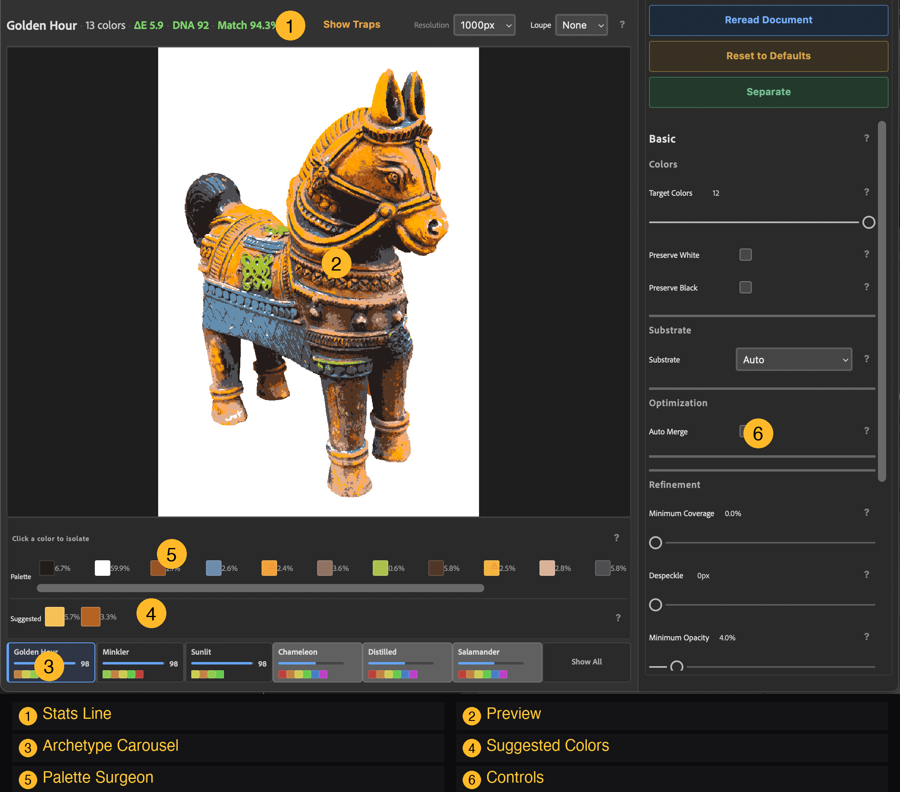

# Reveal User Guide

Reveal is an opinionated color separation tool for screen printing.

## What Reveal Does

Reveal takes a full-color image and reduces it to a handful of spot colors — typically 5 to 8. Each color gets its own screen, ready for film positives and burning screens.

In Photoshop, spot-color separations are traditionally built by hand using **Indexed Color mode plus palette edits**, or repeated rounds of **`Select → Color Range` and `Layer via Cut`**. Both approaches are tedious, labor-intensive, and fundamentally blind to the physical realities of screen printing: Photoshop is a general-purpose digital editor that knows nothing about mesh count (TPI), thread diameters, or what will physically hold on press. In non-halftone modes, Photoshop easily generates isolated 1-pixel specks and razor-thin lines that create very small open areas that are extremely difficult to hold in the washout booth.

Reveal bridges that physical gap. It makes opinionated spot-color reductions, entirely eschewing halftone dots of any sort to fake gradients. Instead of reproducing continuous tones with dots, it discovers the most important colors in your image — including vivid accents that cover only a few pixels of the canvas — and commits to them. Most importantly, it enforces a physical dot floor based on your screen mesh (the "Rule of N"), ensuring every open area on every screen will actually wash out, hold, and print cleanly on press.

If you need photographic reproduction of a continuous-tone original, 4-color process (CMYK) or simulated process printing are established, demanding crafts that printmakers depend on to make a living. If you have the freedom to **interpret** the input image rather than reproduce it, Reveal gets you there faster and gives you screens your press can actually hold.

## How It Works

Reveal's process has four stages: **analyze**, **match**, **preview**, and **separate**.

**Analyze.** When you open an image, Reveal scans it and produces a **DNA fingerprint** — a compact summary of the
image's lightness, color intensity, contrast, texture, color temperature, and hue distribution. This takes about a
second.

**Match.** The DNA is compared against a library of built-in **archetypes**. Each archetype is a separation strategy
tuned for a different kind of image — warm portraits, bold graphics, dark moody scenes, pastel high-key, and so on.
Reveal ranks the archetypes against the image and picks the best fit, but you can switch to any archetype you like.

**Preview.** Reveal generates a color palette and a preview showing exactly what the separation will look like with the selected archetype.
The preview updates live as you browse archetypes, edit the color palette, or adjust controls. What you see is what you
get — the final output uses the same engine and settings.

**Separate.** When you're happy with the preview, you separate. Reveal maps every pixel
to the nearest palette color, and creates one Photoshop layer per ink.

### Key Concepts

- **Archetype** — A separation recipe. "Everyday Photo" favors earth tones and faithful reproduction. "Minkler"
  pushes contrast and saturation for bold graphic impact. "Fine Art Scan" protects subtle textures and tonal transitions.
  There are 26 archetypes grouped into Natural, Soft, Graphic, Dramatic, Vibrant, and Specialist families, plus 3
  adaptive pseudo-archetypes — **Chameleon** (Mk2 interpolator, adapts centroids to image DNA), **Distilled**
  (furthest-point sampling for maximum color spread), and **Salamander** (DNA-driven color count) — that tune their
  routing logic to your image automatically.
- **DNA** — The image's structural fingerprint. It captures lightness, chroma, contrast, entropy, temperature, and hue
  distribution. You don't interact with it directly — it drives the automatic archetype ranking.
- **Dual-Scale Resolution** — Edge-adaptive separation. Bimodal high-contrast boundaries (text, keylines, engravings)
  snap at native 1-pixel resolution, while smooth gradients and halftones remain bound to physical macro-cell dot clusters.
  This ensures razor-sharp letterforms without sacrificing press ink coverage.
- **Rule of N** — The physical relationship between your screen mesh and printable detail: the smallest printable dot
  must span at least N mesh openings ($N \in [4.0, 10.0]$, default 7.0). This prevents ink starvation, pinholes, and
  blowouts in the washout booth.
- **Palette** — The set of spot colors extracted from your image, typically 5-8 colors. You can edit, merge, delete, or
  add colors using the Palette Surgeon before committing.
- **Mechanical Knobs** — Post-processing controls for deep press tuning: Minimum Coverage (eliminate weak colors),
  Despeckle (coupled to your mesh and Rule of N floor), Minimum Opacity (prevent faint density dropouts), Trapping
  (directional light-under-dark overlap), and Black Snap (keyline edge stabilization).
- **Pre-Flight Verification** — Automated offline audit tool (`reveal verify <file.psd>`) that mathematically proves your
  delivered PSD meets all physical press invariants before burning screens.

## Requirements

- Adobe Photoshop 2023 or later (Mac or Windows)
- An image to separate

## Installing the Plugin

1. Download the latest `.ccx` file from the [Releases](https://github.com/electrosaur-labs/reveal/releases) page
2. Double-click the `.ccx` file to install (or drag it onto Photoshop)
3. Restart Photoshop if prompted
4. In Photoshop: **Plugins → Electrosaur → Reveal...**

The plugin dialog opens and auto-reads your active document.

## The Interface



The Reveal dialog has six areas, numbered in the screenshot above.

### 1. Stats Line

The bar across the top of the dialog. It shows the active separation engine, ink count, ΔE (color accuracy — lower is
better), DNA match score, and overall production match percentage. This is your at-a-glance readout: if the numbers look
good and the preview looks right, you're ready to separate.

### 2. Preview

The large center panel. This is a live preview of your separation — same engine, same palette, same knobs as the final
output.

**Blink comparator:** Click the preview to toggle between your original image and the separated version. Hold the click
for 300ms to enter continuous blink mode — the view alternates automatically so you can spot color drift without
clicking repeatedly. Release to snap back to the separated view.

**Show Traps:** The status bar button (visible after analysis, grayed out when Trap Width = 0) overlays trap expansion
zones on the preview. Trap zones are painted at full ink color over a dimmed composite — a quick check that trapping
is covering the right edges before you commit. Disabled while a swatch is selected.

The **Loupe** lets you zoom into any area. At full magnification (1-to-1) you see the actual pixels that will appear in the final
separation.

### 3. Archetype Carousel

The gallery at the bottom. Each card represents a separation strategy — a different opinion about how your image should
be interpreted.

- The **top 3 picks** are pre-selected (highest match scores for your image's DNA)
- **Filter chips** narrow the list: Natural, Soft, Graphic, Dramatic, Vibrant, Specialist
- **Sort** by Score (composite quality), ΔE (color accuracy), DNA (parameter match), or screen count
- **Click any card** to switch — the preview updates live

The blue bar on each card shows how well that archetype fits your image (longer = better fit). Don't overthink scores —
browse a few and pick the one that looks right in the preview.

### 4. Suggested Colors

Hues the engine detected in your image that didn't make it into the palette — for example, a green that got absorbed
into a neighboring color. Suggested colors appear below the palette swatches.

- **Click** — preview the color in isolation
- **Ctrl+click** — mark it for inclusion at commit time

When included, every pixel is reassigned to whichever palette color it's closest to, so pixels that were forced into a
neighbor now go to the new color if it's a better match.

### 5. Palette Surgeon

The swatch strip to the left of the preview. Each swatch represents one ink color in your separation.

| Action                    | What it does                                                               |
|---------------------------|----------------------------------------------------------------------------|
| **Click** a swatch        | Isolate that ink in the preview — see exactly where it prints              |
| **Ctrl+click** a swatch   | Open Photoshop's color picker to replace the color with an exact ink match |
| **Drag** swatch A onto B  | Merge the two colors (B absorbs A's pixels)                                |
| **Alt+click** on a swatch | Delete that color — pixels go to the nearest remaining color               |
| **Click +**               | Add a new color via Photoshop's color picker                               |

### 6. Controls

The controls in the right panel. These affect the final output without changing the palette:

| Knob                     | What it does                                          | When to use it                                          |
|--------------------------|-------------------------------------------------------|---------------------------------------------------------|
| **Target Colors**        | Target number of colors in the palette                | More colors = more fidelity but more screens            |
| **Minimum Coverage**     | Merges colors covering less than X% of the image      | Turn up to eliminate weak colors not worth keeping       |
| **Despeckle**            | Removes isolated pixel clusters smaller than X pixels | Leave at 0 to set it automatically from Mesh and Rule of N |
| **Minimum Opacity**      | Sets minimum mask density for faint areas             | Turn up if faint tones are barely visible in output     |
| **Mesh**                 | Your screen's mesh count (TPI), from 110 to 355, or none | Set it to the mesh you'll burn; Reveal won't produce detail finer than it can hold |
| **Rule of N**            | How many mesh openings the smallest printable dot must span (4–10, default 7) | 7 is a safe default; 4–5.5 for tight, high-tension screens; 8–10 for heavy ink or rough paper |
| **Dither**               | Pattern used to suggest in-between tones: none, Floyd-Steinberg, Atkinson, Bayer or Stucki | None for hard-edged graphic work; the dither is scaled to your mesh |
| **Trap Width**           | Color trapping overlap width                          | Set based on registration tolerance                     |
| **Black Snap**           | Snaps near-black pixels on strong edges to pure black before reduction | For line art and engraving-style images, so hatching and keylines print as one solid black |

**Advanced panels** (click section headers to expand) expose deeper controls: chroma boost, palette reduction threshold,
hue lock, lightness/chroma weights, highlight/shadow points, substrate tolerance, and noise. Most users won't need
these.

Every knob has a `?` button that explains what it does.

## The Workflow

### Step 1: Prepare Your Image

Open your image in Photoshop. Before launching Reveal:

- **Flatten** to a single layer (Layer → Flatten Image)
- **Lab mode** — convert if needed (Image → Mode → Lab Color)
- **8-bit or 16-bit** per channel — both work; 16-bit gives better results for photos with subtle gradations

### Step 2: Launch and Ingest

Launch Reveal (Plugins → Electrosaur → Reveal...). The plugin reads your document and runs DNA analysis — a fast scan
that fingerprints the image's color temperature, contrast, chroma distribution, and texture.

Progress shows in the **stats line** (1). Takes 1-3 seconds depending on image size.

### Step 3: Browse and Choose

The **archetype carousel** (3) populates with ranked cards. Click cards to explore — the **preview** (2) updates live.
Click the preview to toggle between original and separated to check color fidelity.

### Step 4: Refine the Palette

Use the **palette surgeon** (5) to edit colors. Click swatches to isolate inks in the preview. Merge, delete, replace,
or add colors until the palette matches your ink set.

### Step 5: Dial In the Knobs

Use the **controls** (6) to adjust ghost screen removal, dust removal, shadow floor, and trap size. Watch the preview — it updates with every change.

### Step 6: Separate

When the preview looks right, click **Separate**.

The engine maps every pixel to the palette and creates layers in Photoshop:

- One **fill layer** per ink color
- Each layer has a **mask** defining where that ink prints

Reveal assumes a white substrate. If you're printing on colored garments, you'll need to account for the base color
yourself (e.g., adding a white underbase layer).

A 20-megapixel image typically separates in 1-2 seconds.

## Tips

- **Start by browsing the top picks.** The DNA matching is usually right. Browse others if the palette feels wrong, not as a
  default habit.
- **Check isolations.** Click each swatch to see what that ink covers. If a color only appears in tiny scattered spots,
  consider deleting it or increasing Ghost Screen Removal.
- **Use suggested colors** when the palette is missing an obvious hue — the engine spots these automatically.
- **16-bit input** produces better results for photographic images, especially greens and subtle tonal gradations.
- **Dithering** (in Advanced controls) adds halftone-style transitions between colors. Floyd-Steinberg is classic error diffusion. Atkinson is sharp and clean. None gives hard-edged posterization.
- **Reread Document** (top-right button) re-ingests the active document if you've made changes in Photoshop since
  opening the dialog.
- **Shadow Floor and mud.** On press, dark tones can collapse into a single indistinct "mud" color. Use Shadow Floor to
  set a minimum ink density so faint areas maintain enough opacity to print as distinct tones.

## Pre-Flight Verification (`reveal verify`)

Before outputting film positives or burning expensive screens, you can mathematically prove that your delivered separation file is press-safe using Reveal's built-in CLI auditor:

```bash
# Verify a separated PSD before burning screens
reveal verify output.psd

# Strict production audit with detailed layer-by-layer breakdown
reveal verify output.psd --verbose --strict
```

### What It Audits

1. **Embedded Manifest Verification:** Reads the embedded XMP Manifest v2.1 metadata from the PSD, verifying document dimensions, DPI, mesh count, Rule of N setting, dot floors, and trapping parameters.
2. **Sub-Mesh Dot Geometry:** Uses an exact **Euclidean Distance Transform (EDT)** to measure the maximum inscribed disk of every connected shape on every screen mask. Any isolated ink specks or pinholes smaller than your physical mesh floor ($\frac{\text{floorPx}}{2}$) are flagged as press hazards, while continuous linework and filaments are disambiguated and protected.
3. **Trapping Containment & Dilation:** Proves that all trap expansion zones are strictly directional (lighter inks dilated under darker inks, never the reverse), bounded within the specified Euclidean radius ($d \le r + 0.5\text{px}$), and contain zero substrate bleed or over-trapping on your darkest keyline ink.
4. **Canvas Coverage:** Guarantees total opaque canvas coverage with zero unprinted holes or unassigned pixel dropout.

### Exit Codes & Automation
* **`0 (PASS)`** — Clean bill of health; all screens are guaranteed to physically hold on press.
* **`1 (FAIL)`** — Press invariant violations found (sub-mesh debris, reverse trapping, or missing layers).

## Command-Line Tool

Reveal also ships as a standalone command-line tool that accepts standard image formats (PNG, TIFF, JPEG) — no Photoshop required. It runs the same separation engine and can output flat posterized images, layered PSDs, individual screen masks, and JSON metadata.

```bash
# Basic separation with screens output
reveal photo.png --format screens -o output/

# Export layered PSD and individual screen masks
reveal photo.png --format psd,screens -o output/

# Pre-flight audit of an existing separation
reveal verify output/photo.psd
```

See the full [CLI documentation](../packages/reveal-cli/README.md) for all flags, recipe files, and output format details.

## Known Limitations

- Input must be **Lab mode**. Convert RGB or other modes first in Photoshop (Image → Mode → Lab Color).
- Input must be **flattened** to a single layer.
- On Mac, double-clicking `.ccx` may fail — drag it onto Photoshop instead, or use the Creative Cloud Desktop app.
- After separation, Photoshop may show only 1 layer until you switch documents and back. This is a Photoshop UI refresh
  bug — your layers are all there.

## Glossary

| Term                     | Meaning                                                                                                                                       |
|--------------------------|-----------------------------------------------------------------------------------------------------------------------------------------------|
| **Archetype**            | A separation strategy — defines how many colors, which distance metric, and how to weight the color science parameters                        |
| **DNA**                  | The image's structural fingerprint — captures lightness, chroma, contrast, entropy, temperature, and hue distribution                         |
| **Dual-Scale**           | Edge-adaptive resolution snapping 1px vector boundaries on linework while locking gradients to press-safe macro-cells                         |
| **Rule of N**            | The physical mesh floor: the smallest printable dot must span at least N mesh openings ($N \in [4, 10]$, default 7)                          |
| **Lab**                  | CIELAB color space — perceptually uniform, used for all internal calculations because it matches how humans see color                         |
| **Median cut**           | Classical color quantization algorithm — recursively splits the color volume along the axis of greatest variance                             |
| **Wu Quantizer**         | Xiaolin Wu's variance-minimizing partitioner with vibrancy weighting — minimizes sum-of-squares perceptual error in CIELAB space              |
| **ΔE (Delta-E)**         | Perceptual color distance — how far a separated pixel drifts from its original color. Lower is better.                                        |
| **Screen**               | The final output layer / positive — a solid color fill layer with mask, representing one screen on press                                      |
| **Palette**              | The set of spot colors extracted from your image                                                                                              |
| **Minimum coverage**     | A color covering very little of the image — may not be worth keeping in the palette                                                           |
| **Despeckle**            | Removes isolated pixel clusters smaller than your physical mesh floor                                                                         |
| **Trap**                 | Bounded, directional overlap between adjacent colors that prevents white gaps from paper misregistration on press                           |
| **Pre-Flight Inspector** | The `reveal verify` tool that audits PSDs for sub-mesh debris, directional trapping dilation bounds, and press invariants                     |
