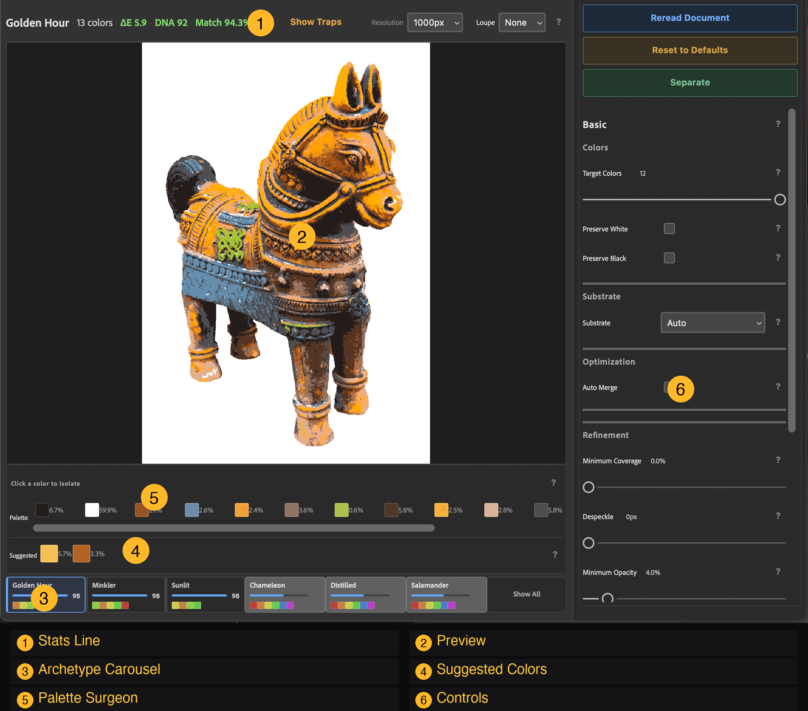

# @electrosaur-labs/navigator

Photoshop UXP plugin for real-time color separation preview and production rendering.

This is the main user-facing plugin. It opens as a command dialog (Plugins > Electrosaur > Reveal...), ingests the active document, and provides interactive archetype exploration with live preview. When you're satisfied, click Separate to render full-resolution Lab fill+mask layers.

<p align="center">
  
</p>

## Requirements

- Adobe Photoshop 2023 (v23.3) or later
- UXP Developer Tool (for loading during development)

## Loading the Plugin

1. Build: `npm run build:navigator` (from monorepo root) or `npm run build` (from this directory)
2. Open **UXP Developer Tool** in Photoshop
3. Click **Add Plugin** → select `dist/manifest.json`
4. Click **Load**
5. In Photoshop: **Plugins → Electrosaur → Reveal...**

## UI Overview

### Archetype Carousel
Horizontal card strip showing 26 archetypes plus 3 adaptive pseudo-archetypes (Chameleon, Distilled, Salamander), ranked by match score. Filter chips (Natural, Soft, Graphic, Dramatic, Vibrant, Specialist) narrow the list. Sort by Score, ΔE, DNA, or screen count. Click a card to switch — the preview updates in real time.

### Preview
1000px proxy of your separation (long edge). Shows exactly what the final output will look like.

- **Click** — toggle between original image and separated preview (blink comparator)
- **Hold click 300ms** — enter continuous blink mode (alternates automatically); release to snap back
- **Show Traps** (status bar button) — overlay trap expansion zones on the preview; zones are painted at full ink color over a dimmed composite. Only available when Trap Width > 0 and no swatch is selected.

Click any palette swatch to isolate a single ink in the preview (disables blink comparator and Show Traps while active).

### Palette Surgeon
Extracted color palette as editable swatches:
- **Click** — isolate that color in the preview
- **Ctrl+click** — open Photoshop color picker to override a color
- **Drag A onto B** — merge two colors
- **X badge** — delete a color

Suggested colors (missing hues detected by K-Means++ analysis) appear below the palette.

### Mechanical Knobs
Post-processing sliders:
- **Target Colors** — number of ink screens
- **Ghost Screen Removal** — merges colors below coverage threshold
- **Dust Removal** — morphological despeckle for isolated pixels
- **Shadow Floor** — clamps faint mask values to printable density
- **Trap Width** — color trapping width for misregistration compensation

Advanced panels expose chroma, palette, weight, tone, substrate, and noise controls.

### Separate
Renders the full-resolution document with the locked palette. Creates Lab fill+mask layers — one per ink color. Uses nearest-neighbor mapping (no re-posterization).

### Credits
Click **★ Credits** in the status bar to open the dedicated crawling credits window celebrating the printmakers, algorithmic pioneers, and contributors behind Reveal. Pause anytime by hovering over the text, browse freely with native scrollbars, and dismiss smoothly by clicking elsewhere on the dark backdrop.

## Development

```bash
npm run build        # Production build (webpack)
npm run watch        # Watch mode
npm test             # Vitest tests
```

## License

[Apache-2.0](../../LICENSE)
